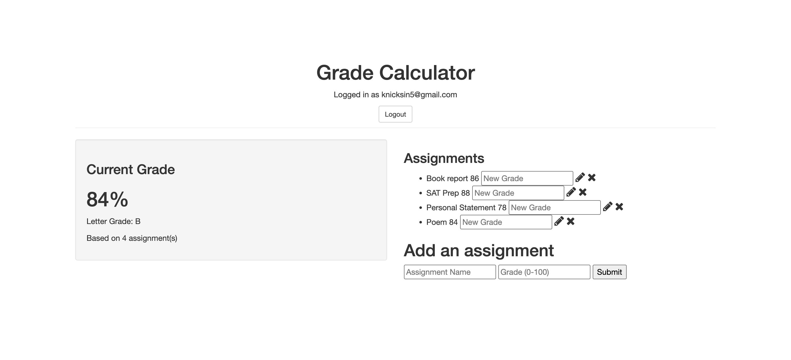

# Greater Grader

**Know where you stand.** Greater Grader is a personal grade calculator that you can use to calculate your grade without going to your professor. Keep track of your own work. Log in, enter your assignments and the scores you got, and it works out your current average and letter grade for you.



## Features

- **User accounts:** sign up and log in with email and password. Passwords are hashed with bcrypt, and sessions are handled by Passport.
- **Personal gradebook:** each user only sees the assignments they've entered.
- **Add assignments:** enter an assignment name and a grade from 0 to 100.
- **Automatic average:** your current grade is calculated from all your assignments and rounded to one decimal place.
- **Letter grade:** the average is converted to a letter on a standard scale (A 90+, B 80+, C 70+, D 60+, F below 60).
- **Edit grades:** type a new grade next to an assignment and click the pencil. Your average updates right away.
- **Delete assignments:** click the ✖ to remove one.

## Tech Stack

- **Backend:** Node.js, Express
- **Database:** MongoDB (Atlas), with Mongoose for users and the native driver for assignments
- **Auth:** Passport.js (local strategy), bcrypt-nodejs, express-session, connect-flash
- **Templating:** EJS
- **Frontend:** vanilla JavaScript (Fetch API), Bootstrap 3, Font Awesome

## Getting Started

### Prerequisites

- [Node.js](https://nodejs.org/) and npm
- A MongoDB database, either a free [MongoDB Atlas](https://www.mongodb.com/atlas) cluster or a local MongoDB install

### Installation

1. Clone the repo:
   ```bash
   git clone <your-repo-url>
   cd greater_grader
   ```
2. Install dependencies:
   ```bash
   npm install
   ```
3. Create a `.env` file in the project folder with your MongoDB connection string and a session secret:
   ```
   MONGO_URI=your-mongodb-connection-string
   SESSION_SECRET=any-long-random-string
   ```
   The `users` and `assignments` collections are created automatically the first time you use the app.

### Running the app

```bash
node server.js
```

Then open **http://localhost:8081** in your browser. To use a different port, set the `PORT` environment variable.
